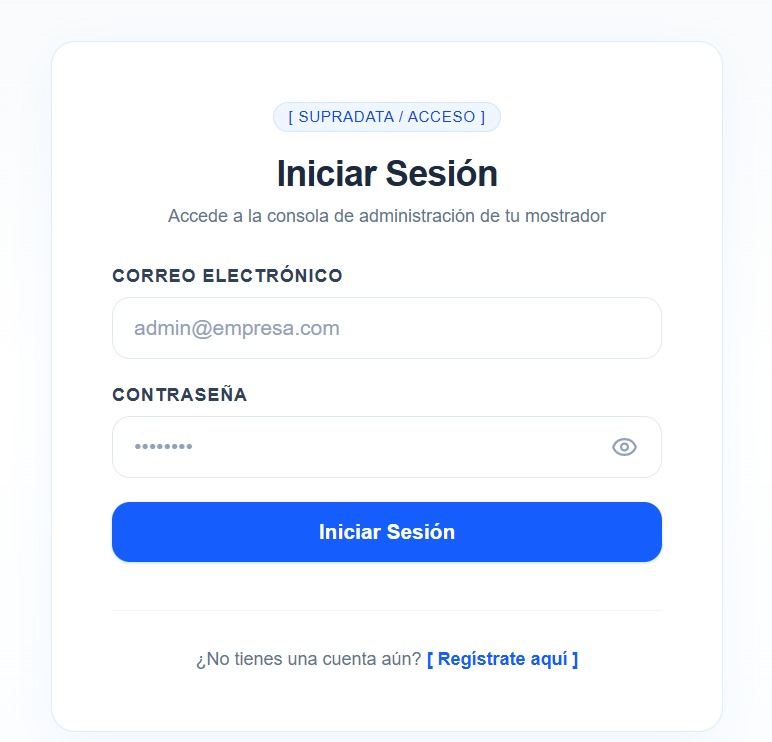
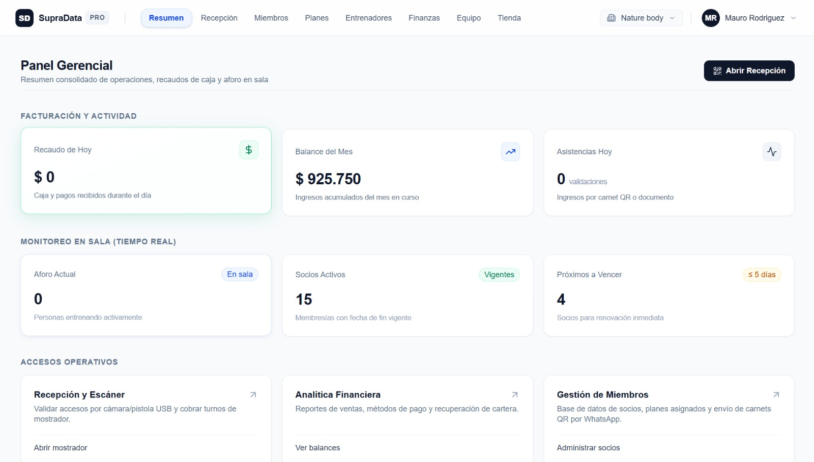
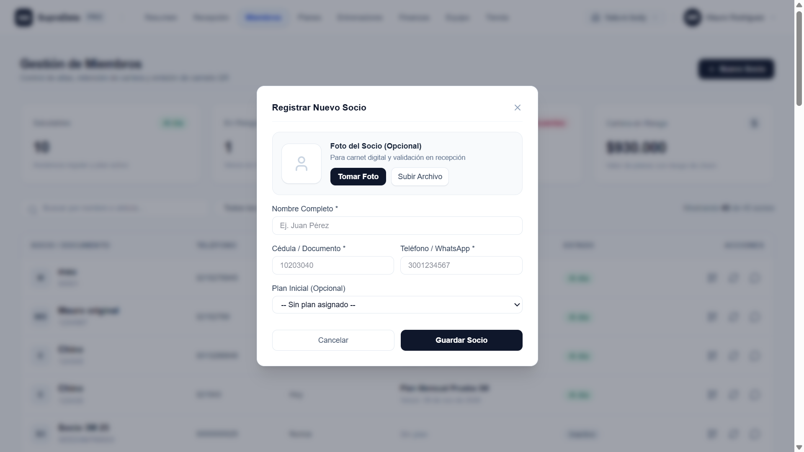
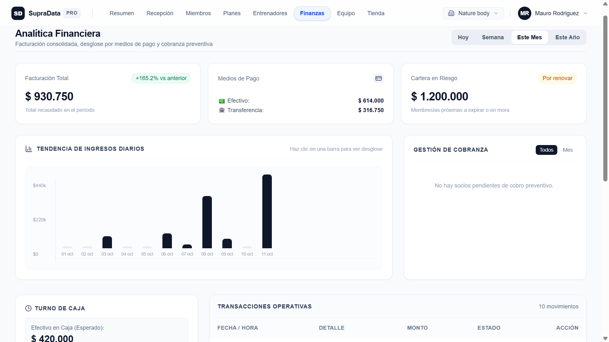
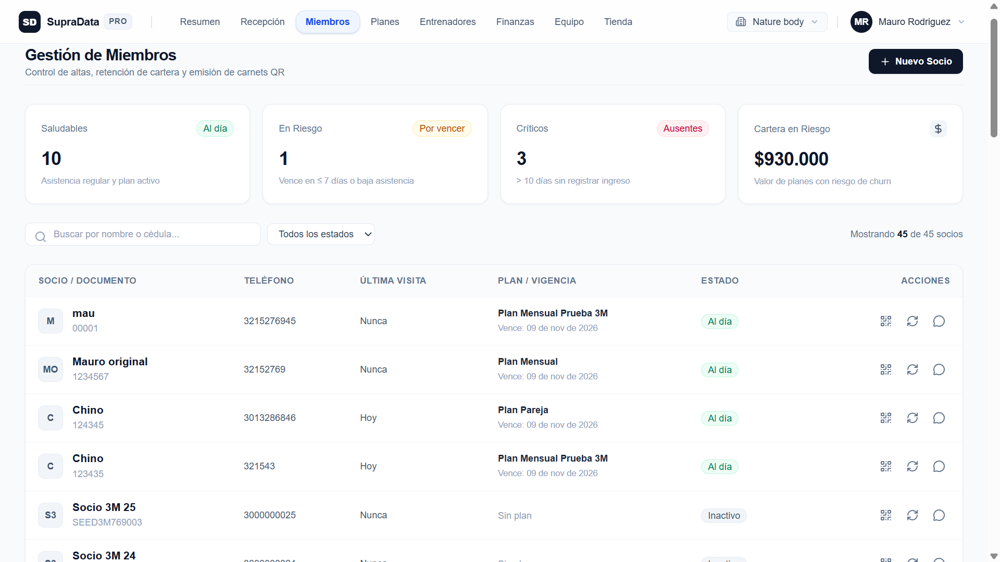

# Manual de Usuario y Guía Operativa — SupraData

Bienvenido a **SupraData**, el sistema integral de gestión y copiloto financiero diseñado especialmente para optimizar las operaciones diarias, el control de accesos y la rentabilidad de tu gimnasio.

Este manual está diseñado para acompañar tanto a **propietarios y administradores** como a **recepcionistas y cajeros**, guiándolos paso a paso a través de cada módulo de la plataforma.

---

## Índice General

1. [Introducción y Primeros Pasos](#1-introducción-y-primeros-pasos)
2. [Panel Gerencial (Dashboard)](#2-panel-gerencial-dashboard)
3. [Módulo de Recepción y Caja](#3-módulo-de-recepción-y-caja)
4. [Auditoría y Arqueo Ciego (Finanzas)](#4-auditoría-y-arqueo-ciego-finanzas)
5. [Gestión de Socios y Recuperación por WhatsApp](#5-gestión-de-socios-y-recuperación-por-whatsapp)
6. [Buenas Prácticas Operativas y Preguntas Frecuentes](#6-buenas-prácticas-operativas-y-preguntas-frecuentes)

---

## 1. Introducción y Primeros Pasos

### 1.1 ¿Qué es SupraData y cómo reemplaza al Excel tradicional?

Llevar el control de un gimnasio en hojas de cálculo de Excel suele convertirse en un dolor de cabeza diario: fórmulas desconfiguradas, cobros no registrados, falta de control en los turnos de caja, carnets de cartón que se prestan entre personas y membresías vencidas que nadie detecta a tiempo.

**SupraData** transforma esta realidad convirtiéndose en el copiloto operativo de tu gimnasio:

* **Control de acceso blindado:** Validación en tiempo real por escáner de código QR dinámico o documento de identidad, con sistema de prevención de entradas duplicadas (*Anti-Passback* de 120 minutos).
* **Cero fugas de dinero:** Sistema de turnos con arqueo ciego donde el personal de mostrador no puede cuadrar cajas ficticias.
* **Recuperación activa de ingresos:** Algoritmo que calcula qué socios están en riesgo de deserción y te permite enviarles un recordatorio personalizado por WhatsApp con un solo clic.
* **Carnet digital en la nube:** Tus clientes no necesitan descargar aplicaciones pesadas; acceden a su pase digital directamente desde el navegador de su teléfono móvil.

---

### 1.2 Cómo iniciar sesión por primera vez

Para comenzar a operar en la plataforma:

1. Abre tu navegador web (Google Chrome, Microsoft Edge o Safari recomendado) e ingresa al enlace de tu plataforma: `https://tudominio.com/login` (o la dirección local asignada).
2. Ingresa tus credenciales autorizadas:
   * **Correo electrónico:** El correo corporativo asignado para tu usuario.
   * **Contraseña:** Tu clave personal de acceso.
3. Haz clic en el botón **Iniciar Sesión**.

> **Nota sobre Roles de Usuario:**
> * **Propietario / Administrador (`Owner`):** Tiene acceso ilimitado a todas las métricas de ingresos, balances mensuales, configuración de planes, entrenadores, equipo de trabajo y auditoría de turnos.
> * **Recepcionista (`Receptionist`):** Visualiza los módulos operativos diarios: Recepción, Control de Asistencias, Registro de Nuevos Socios, Tienda de Mostrador y Apertura/Cierre de su propio turno de caja.

---

## 2. Panel Gerencial (Dashboard)

El **Panel Gerencial** es el centro de control del administrador. Ofrece una vista panorámica instantánea de cómo marchan las finanzas y la afluencia de personas en el gimnasio el día de hoy y durante el mes corriente.

### 2.1 Desglose de Métricas Principales

* **Recaudo de Hoy:**
  * Representa el total neto de dinero ingresado en la fecha actual (desde las 00:00 hasta la hora actual).
  * Incluye pagos de suscripciones, pases diarios exprés y ventas de mostrador cobradas tanto en **Efectivo** como por **Transferencia**.
* **Balance del Mes:**
  * Muestra la utilidad operativa acumulada del mes calendario: `Total Ingresos del Mes - Total Gastos Operativos Menores`.
  * Te permite evaluar la rentabilidad real de la sede sin esperar al cierre contable de fin de mes.
* **Asistencias Hoy:**
  * Número total de validaciones de acceso registradas por recepción en el transcurso del día.
* **Aforo Actual (Monitoreo en Vivo):**
  * Conteo de socios que se encuentran actualmente entrenando dentro de las instalaciones (calculado con base en ingresos registrados dentro de las últimas 2 horas que no han marcado salida).
* **Socios Activos:**
  * Total de socios cuya fecha de vigencia de plan finaliza hoy o en días futuros.

---

### 2.2 Cómo interpretar las alertas de "Socios Próximos a Vencer"

El bloque de alerta **Próximos a Vencer (≤ 5 días)** identifica a aquellos socios cuyo plan comercial está por caducar dentro de los próximos 5 días calendario.

1. **Importancia del indicador:** El momento con mayor probabilidad de retener a un cliente es *antes* de que su plan venza, no semanas después cuando ya ha perdido el hábito de asistir.
2. **Acción sugerida:** Al hacer clic en este bloque o dirigirte a la sección **Miembros**, encontrarás la lista priorizada para enviarles el mensaje de renovación de cortesía antes de que finalice su período activo.

---

## 3. Módulo de Recepción y Caja

El módulo de **Recepción** (`/dashboard/reception`) es la herramienta de trabajo continua para el personal de mostrador. Está diseñado para operar con máxima rapidez y sin fricción durante las horas pico.

### 3.1 Apertura Obligatoria de Turno

Al iniciar el turno, si no hay una caja activa, el sistema solicitará de forma obligatoria la **Apertura de Turno**:

1. Ingresa el **Monto Inicial en Efectivo** (la base de dinero en billetes y monedas que hay físicamente en el cajón).
2. Haz clic en **Abrir Turno**. A partir de este momento, cada movimiento en efectivo quedará asociado a tu usuario.

---

### 3.2 Registro de Acceso de un Socio

Para validar el ingreso de un socio:

* **Método 1: Pistola lectora USB o Lector de Código QR:**
  * Si tienes lector físico conectado a la computadora, el código escaneado se procesa automáticamente.
  * También puedes pulsar el botón **[ Escanear con Cámara ]** para encender la cámara web y leer el QR del carnet digital del socio.
* **Método 2: Búsqueda por Documento (Cédula):**
  * Escribe el número de documento del socio en el campo de texto central.
  * Presiona la tecla `Enter` o haz clic en **Validar Acceso**.

#### Resultados del Semáforo de Acceso:
* **Verde (Acceso Autorizado):** El socio cuenta con membresía activa. El sistema muestra su nombre completo, fotografía facial registrada, plan actual y días restantes.
* **Rojo (Membresía Vencida / Inactiva):** El sistema alerta que el plan ha caducado. Se ofrece de inmediato la opción de **Cobrar Renovación**.
* **Amarillo (Control Anti-Passback):** Si un carnet intenta ser usado dos veces dentro de los 120 minutos de una sesión ya iniciada, el sistema bloquea el reingreso para evitar préstamos indebidos de carnets entre usuarios.

---

### 3.3 Flujo de Captura de Fotografía (Uso de Cámara Web)

Para garantizar la identidad del socio y evitar suplantaciones, SupraData incluye un visor fotográfico interactivo de alta calidad:

1. Al dar de alta a un socio o actualizar su carnet, haz clic en **Tomar Fotografía con Cámara**.
2. Se abrirá la ventana emergente de captura:
   * **Encuadre asistido:** Coloca el rostro del cliente dentro de la guía circular central marcada como *"Rostro aquí"*.
   * **Alternancia de cámara:** Si estás operando desde una tablet o smartphone, puedes usar el botón **Cambiar a Trasera** o **Cambiar a Frontal** para elegir la cámara adecuada.
3. Haz clic en el botón verde **Capturar Foto**.
4. Se desplegará la vista previa:
   * Si la imagen quedó desenfocada o con mala iluminación, pulsa **Repetir / Reintentar**.
   * Si la imagen es nítida, pulsa **Guardar y Usar Foto**. La fotografía se asociará automáticamente a la ficha del socio.

---

### 3.4 Registro de Pagos Rápidos en Mostrador

#### Pase Exprés (Entrada por un día):
1. Selecciona la pestaña **Pase Exprés**.
2. Ingresa el nombre o documento de la visita.
3. Elige el método de pago:
   * **Efectivo:** Se sumará automáticamente al arqueo de caja física del turno.
   * **Transferencia:** Solicita el número de comprobante o referencia bancaria y escríbelo en el campo **Referencia / Soporte**.
4. Pulsa **Registrar Cobro e Ingreso**.

#### Venta de Productos (Bebidas, Snacks, Suplementos):
1. Selecciona la pestaña **Tienda de Mostrador**.
2. Haz clic en los productos solicitados por el socio (ej. Agua, Bebida Isotónica, Proteína).
3. Selecciona el método de pago (**Efectivo** o **Transferencia**).
4. Confirma la venta con el botón **Finalizar Venta**.

#### Gastos Menores de Caja:
Si durante el turno debes tomar dinero del cajón para un gasto urgente menor (ej. compra de agua de botellón, implementos de aseo):
1. Haz clic en **Registrar Gasto de Caja**.
2. Escribe el **Monto exacto** y la **Descripción / Motivo** detallado.
3. Pulsa **Guardar Gasto**. Este valor se deducirá automáticamente del efectivo esperado en el arqueo final.

---

## 4. Auditoría y Arqueo Ciego (Finanzas)

La conciliación financiera de SupraData está construida bajo el principio de **Arqueo Ciego**, una de las mejores prácticas para blindar los ingresos de los negocios contra fugas y descuidos.

### 4.1 ¿Qué es el Arqueo Ciego y por qué protege tu dinero?

En los sistemas tradicionales, la pantalla le muestra al recepcionista cuánto dinero "debería haber" en el cajón antes de cerrar el turno. Esto facilita que, si sobra dinero, no se reporte, o que si falta, se intenten ocultar movimientos.

En el **Arqueo Ciego de SupraData**:
* El sistema **no le muestra al recepcionista** el total esperado en efectivo antes del cierre.
* El recepcionista debe contar físicamente los billetes y monedas que tiene en la mano y reportar esa cifra exacta.
* Solo después de registrar la cifra contada, el sistema cruza los datos con las ventas reales y calcula automáticamente si la caja cerró cuadrada, con dinero sobrante o con dinero faltante.

---

### 4.2 Pasos para que el Cajero Cierre su Turno

1. En el módulo de Recepción, haz clic en el botón superior **Cerrar Turno**.
2. Cuenta con calma todo el dinero físico disponible en el cajón de efectivo.
3. En la casilla **Efectivo Físico Contado**, escribe el valor total resultante del conteo.
4. Si hubo alguna novedad (por ejemplo, billetes deteriorados o monedas especiales), puedes anotarlo en el campo de observaciones.
5. Haz clic en el botón rojo **Confirmar y Cerrar Turno**.

---

### 4.3 Cómo el Administrador Revisa los Descuadres

Desde el módulo de **Finanzas** (`/dashboard/finances`), el dueño o administrador puede auditar el comportamiento de la caja:

$$\text{Efectivo Esperado} = \text{Base Inicial} + \text{Ventas en Efectivo} - \text{Gastos Menores}$$

$$\text{Diferencia} = \text{Efectivo Contado por Cajero} - \text{Efectivo Esperado}$$

* **Diferencia = \$0:** Turno perfectamente cuadrado.
* **Diferencia < \$0 (Faltante en Rojo):** Faltó dinero en el cajón físico con respecto a las ventas del sistema.
* **Diferencia > \$0 (Sobrante en Azul):** Hubo más dinero físico del registrado (posible venta cobrada que no fue facturada en el software).

#### Anulación de Cobros Auditada:
Si un cobro fue registrado por error y requiere ser anulado:
* Solo los usuarios con rol de **Propietario / Administrador** pueden realizar anulaciones.
* El sistema exige obligatoriamente escribir el **Motivo de la Anulación**.
* La transacción queda marcada como `Anulada` en el historial contable permanente, conservando el nombre de quién la registró y quién la anuló.

---

## 5. Gestión de Socios y Recuperación por WhatsApp

El módulo de **Miembros** (`/dashboard/members`) es el directorio central de clientes y la principal herramienta para garantizar que ningún socio se marche sin renovar.

### 5.1 Cómo dar de alta a un nuevo socio

1. Dirígete a la sección **Miembros** en el menú de navegación superior.
2. Haz clic en el botón **[ + NUEVO SOCIO ]**.
3. Diligencia los campos requeridos:
   * **Nombre Completo:** Nombres y apellidos del socio.
   * **Número de Documento (Cédula):** Identificación única (evita registros duplicados).
   * **Teléfono Celular:** Número de contacto (fundamental para el envío de recordatorios y carnet).
   * **Plan Inicial:** Selecciona la tarifa o membresía que adquiere (ej. Mensualidad Estándar, Plan Trimestral).
   * **Fotografía:** Puedes subir un archivo de imagen o usar el botón **Tomar Fotografía con Cámara**.
4. Haz clic en **Guardar Socio**.
5. El sistema creará la ficha del cliente, registrará su suscripción y generará un carnet digital con un enlace único y privado.

---

### 5.2 El Carnet Digital del Socio (`/pass/[token]`)

Cada socio registrado cuenta con un carnet digital en la nube accesible desde cualquier celular.

* **Sin necesidad de app:** El socio solo abre su enlace en Chrome o Safari.
* **Código QR dinámico:** Código de seguridad de alta velocidad que refresca su validez periódicamente para evitar clonaciones o capturas de pantalla compartidas.
* **Termómetro de aforo en vivo:** Le muestra al socio el estado de ocupación del gimnasio en las últimas 2 horas para que elija el mejor horario para entrenar.

---

### 5.3 Motor de Recuperación por WhatsApp

En la lista de miembros, cada socio está clasificado con una etiqueta de salud de retención:

| Estado | Significado Operativo | Acción Recomendada |
| :--- | :--- | :--- |
| **Saludable** | Membresía activa con más de 5 días de vigencia y asistencias recientes. | Enviar carnet digital o felicitación de progreso. |
| **En Riesgo** | Membresía a punto de vencer (vence en $\le$ 5 días). | Enviar mensaje preventivo de renovación de cortesía. |
| **Crítico / Inactivo** | Membresía vencida o socio que no asiste hace más de 10 días. | Contactar con oferta de reactivación personalizada. |

#### Cómo enviar el recordatorio en 1 clic:
1. Ubica al socio en la tabla de miembros.
2. Haz clic en el botón verde con el icono o etiqueta **WhatsApp**.
3. El sistema abrirá inmediatamente la aplicación de WhatsApp (en el celular o WhatsApp Web en el computador) con el número del cliente y un mensaje redactado con su nombre y fecha exacta:
   * *Ejemplo En Riesgo:* *"Hola Carlos Gómez, te escribimos del gimnasio. Notamos que tu membresía vence pronto (15/10/2026). ¿Deseas renovar tu plan?"*
   * *Ejemplo Envío de Carnet:* *"Hola Carlos Gómez 💪, aquí tienes tu carnet digital de acceso al gimnasio: https://tudominio.com/pass/abc123xyz. Preséntalo en recepción para ingresar."*
4. Solo debes pulsar **Enviar** en WhatsApp.

---

## 6. Buenas Prácticas Operativas y Preguntas Frecuentes

### 6.1 Rutina Diaria Recomendada

#### Al Iniciar la Jornada (Turno Mañana):
1. Abrir el módulo de **Recepción**.
2. Contar la base de dinero en efectivo física e iniciar el turno con el monto exacto.
3. Verificar que la cámara web o lector de código QR esté conectado y respondiendo.

#### Durante la Jornada:
1. Registrar **cada acceso** sin excepción; esto garantiza que el cálculo de aforo en sala y la tasa de asistencia sean 100% confiables.
2. Si un cliente paga por transferencia, solicitar siempre el comprobante y escribir el número de aprobación en el campo de referencia.
3. Registrar de inmediato cualquier salida de dinero para gastos menores.

#### Al Finalizar el Turno:
1. Realizar el conteo físico de billetes y monedas.
2. Hacer el **Arqueo Ciego** confirmando el efectivo contado.
3. Cerrar sesión de usuario para que el siguiente recepcionista abra su propio turno.

---

### 6.2 Preguntas Frecuentes (FAQ)

**P: ¿Qué hago si la cámara web no se enciende al intentar tomar la foto?**  
*R:* Verifica en la barra de direcciones de tu navegador que los permisos de cámara estén en "Permitir". Si el dispositivo cuenta con más de una cámara conectada, utiliza el botón **Cambiar a Trasera** / **Cambiar a Frontal** o reinicia el navegador.

**P: ¿Qué ocurre si un socio llega sin su teléfono móvil?**  
*R:* No hay inconveniente. El recepcionista simplemente escribe el número de cédula o documento del socio en la barra de búsqueda de recepción y pulsa **Validar Acceso**. El sistema validará su estado de inmediato.

**P: ¿Puede un recepcionista ver las ganancias totales del mes?**  
*R:* No. El módulo de analítica financiera mensual y desglose de ganancias está restringido exclusivamente para usuarios con rol de Administrador / Propietario (`Owner`).

**P: ¿Cómo se gestionan los pagos mixtos o abonos?**  
*R:* Todo cobro debe asociarse a un método predominante (Efectivo o Transferencia). Si un socio realiza un pago parcial, se puede registrar el monto recibido como abono y especificar el saldo restante en el campo de notas.

---

*Documentación oficial generada para la versión estable de SupraData.*  
*Para soporte técnico adicional, contacta al administrador de infraestructura de tu sede.*
